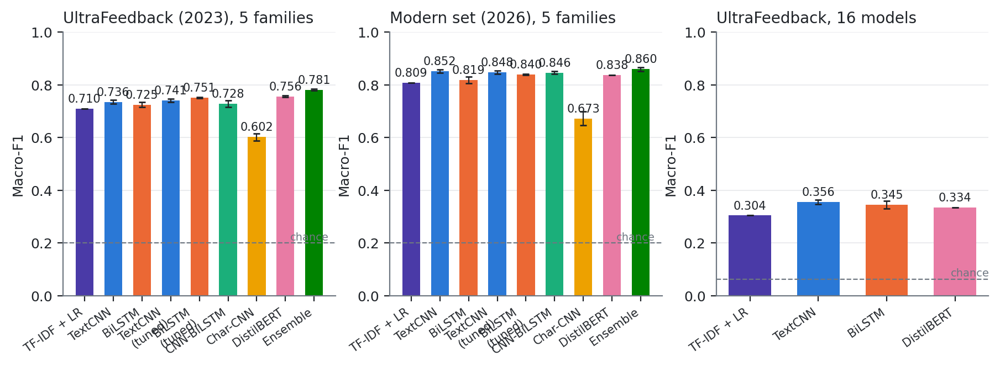
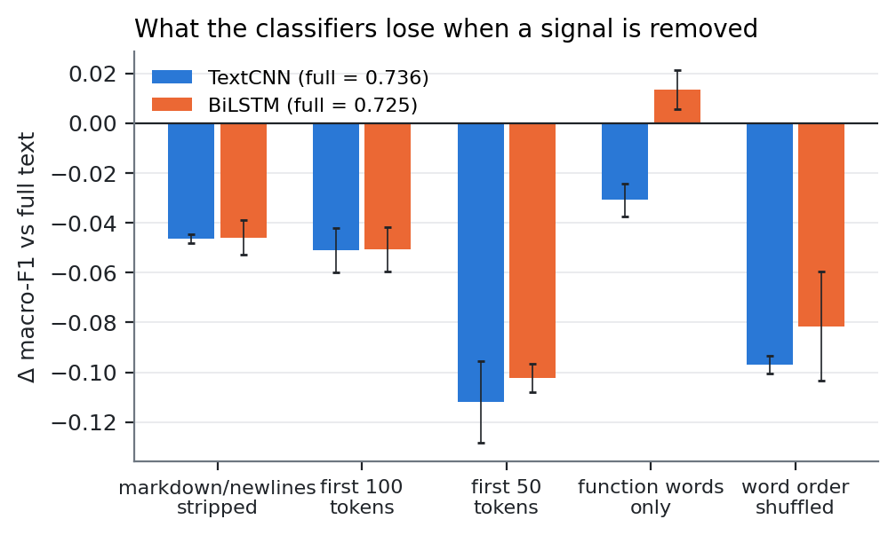
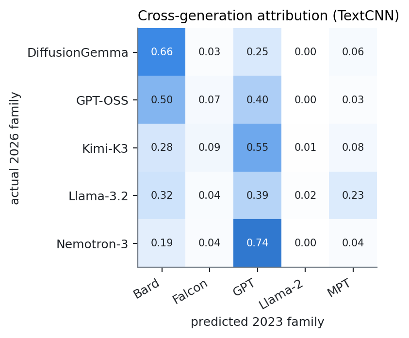
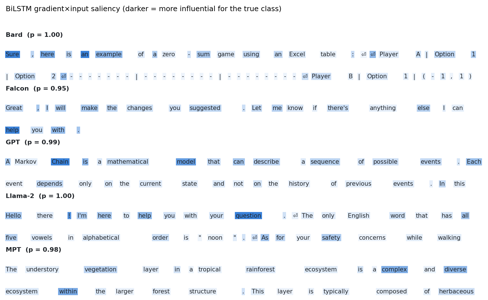

# Who Wrote It? Identifying LLMs from Their Responses

CMPSC 448 midterm project, Penn State, Fall 2026. Individual project by **Advait Sadineni** (team leader and sole member).

> Can a classifier tell *which* language model wrote a response? Yes, well above chance, from the response alone,
> and the signal is mostly style and formatting rather than content.

📄 **Report:** [`report/report.pdf`](report/report.pdf) · 🧪 **Live demo:** [https://advait-sadineni.github.io/llm-fingerprint/demo/](https://advait-sadineni.github.io/llm-fingerprint/demo/) · 📊 Figures in [`figures/`](figures) · 🔢 Every number in [`results/`](results)

<!-- RESULTS_TABLE -->
| Model | UltraFeedback 2023 (5 families) | Modern 2026 (5 families) | UltraFeedback (16 models) |
|---|---:|---:|---:|
| TF-IDF + LR | 0.710 | 0.809 | 0.304 |
| TextCNN | 0.736 ± 0.007 | 0.852 ± 0.007 | 0.356 ± 0.009 |
| BiLSTM | 0.725 ± 0.009 | 0.819 ± 0.013 | 0.345 ± 0.014 |
| TextCNN (tuned) | 0.741 ± 0.007 | 0.848 ± 0.007 | — |
| BiLSTM (tuned) | 0.751 ± 0.002 | 0.840 ± 0.002 | — |
| CNN-BiLSTM | 0.728 ± 0.013 | 0.846 ± 0.005 | — |
| Char-CNN | 0.602 ± 0.013 | 0.673 ± 0.026 | — |
| DistilBERT | 0.756 ± 0.003 | 0.838 | 0.334 |
| Ensemble of four | 0.781 ± 0.003 | 0.860 ± 0.008 | — |

Test macro-F1, mean ± std over 3 seeds where available (response text only). Chance: uf: 0.200 · modern: 0.200 · uf17: 0.062.
<!-- /RESULTS_TABLE -->

## Four findings

1. **Style, not content, is the fingerprint.** Keep only function words, punctuation and line breaks and the BiLSTM scores *higher* than on full text (0.739 vs 0.725). Shuffling word order keeps 0.64.
2. **The prompt tells you nothing about the model** once prompt assignment is controlled. When it seems to, it is the dataset's sampling (source oracle 28% vs chance 20%), not the model.
3. **Fingerprints do not survive a model generation.** A classifier trained on Llama-2-chat labels 2% of Llama 3.2 responses as Llama; 2026 models are sorted by how much markdown they use.
4. **2026 models are easier to identify than 2023 ones** (TextCNN 0.852 vs 0.736), and about a tenth of that comes from typography: gpt-oss's non-breaking hyphens, Nemotron's em dashes, Kimi's leaked `<|close|>` template tokens.

<p align="center">
  
</p>
<p align="center">
   
</p>
<p align="center">
  
</p>

## What is in here

| | |
|---|---|
| **Data A** | [UltraFeedback](https://huggingface.co/datasets/openbmb/UltraFeedback) (MIT) flattened to `(prompt, model, response)`, 5 families × 4,000 responses with an identical prompt-source mix per family, split 80/10/10 **grouped by prompt**. Plus a natural-mix variant and a 16-model fine-grained variant. |
| **Data B** | A modern set I generated myself: the same 1,200 UltraFeedback prompts answered by 5 current model families (Nemotron 3, gpt-oss, Kimi K3, Llama 3.2, DiffusionGemma) through NVIDIA's OpenAI-compatible endpoint. Same prompts for every family, so prompt-only classification is chance *by construction*. |
| **Models** | TF-IDF + logistic regression (baseline), **TextCNN**, **BiLSTM** (the two required models), CNN-BiLSTM hybrid, Char-CNN, DistilBERT (upper bound). |
| **RQ1** | Which LLM wrote this response? |
| **RQ2** | Does the prompt help? (input / output / input+output views, controlled vs natural prompt mix) |
| **RQ3** | Do fingerprints generalise across task domains (leave-one-source-out), across model generations (2023 → 2026), and how little data is needed (learning curves)? |
| **RQ4** | What is the fingerprint made of? Stylometry, ablations (strip formatting, truncate, function words only, shuffle word order), CNN filter probing, BiLSTM saliency, and a paraphrase attack. |

## Reproduce

```bash
pip install -r requirements.txt
python data/download.py            # 940 MB of UltraFeedback jsonl -> data/raw/
python data/build.py               # -> data/uf.csv.gz, uf_natural.csv.gz, uf17.csv.gz, modern_prompts.jsonl (deterministic, seed 42; not committed, 41 MB)
# optional: regenerate the modern set (needs NVIDIA_API_KEY; the generated data is already committed)
# for f in Nemotron-3 GPT-OSS Kimi-K3 Llama-3.2 DiffusionGemma; do python data/generate_modern.py --family $f --rpm 7 & done
python data/build_modern.py        # -> data/modern.csv.gz
bash experiments.sh all            # every run behind the report (~2 h on one RTX 5080 laptop GPU)
python -m src.features uf && python -m src.features modern
python -m src.explain runs/uf_cnn_output_s42.pt && python -m src.explain runs/uf_lstm_output_s42.pt
python -m src.crossgen runs/uf_cnn_output_s42.pt
python -m src.aggregate && python -m src.plots
typst compile --root . report/report.typ report/report.pdf
```

A single experiment is one command, e.g. `python run.py --data uf --model lstm --view both --seed 1`; results land in `results/<name>.json`
with metrics, confusion matrix, training history and test-set probabilities.

## Layout

```
data/      download.py build.py build_modern.py generate_modern.py paraphrase.py + the built datasets
src/       text.py (tokenizer/vocab) models.py (TextCNN, BiLSTM, CNN-BiLSTM, Char-CNN) train.py bert.py
           features.py (stylometry) explain.py (filters, saliency) crossgen.py paraphrase_eval.py aggregate.py plots.py
run.py     one CLI for every experiment        experiments.sh   the full grid
results/   one JSON per run + summary.csv       figures/         every figure in the report
report/    report.typ -> report.pdf (typst)
```

## Acknowledgements

Data: UltraFeedback (Cui et al., 2023). Modern responses generated through [build.nvidia.com](https://build.nvidia.com).
Claude Code was used as a pair programmer throughout: it wrote most of the code and first drafts of the prose under my direction. I set the goals, chose the approach, approved every design decision (dataset construction, controls, model ladder, ablations, the paraphrase attack), ran the pipeline, read every result and made the calls when things broke. The course permits LLM assistance; I can explain every line and every number.
